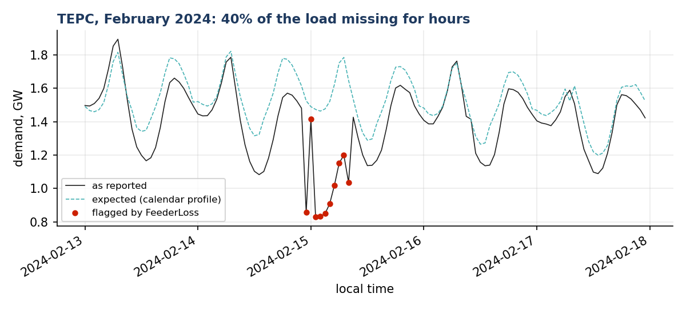
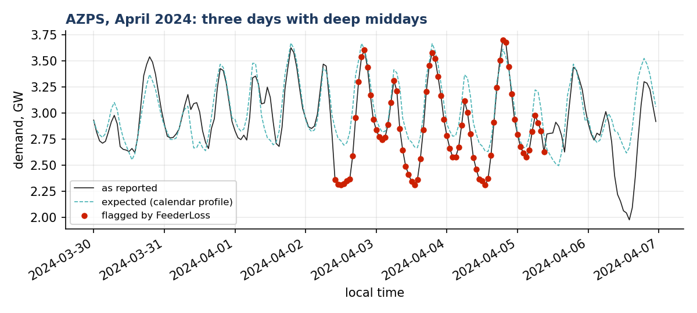

# What v0.5 changes on the public record

The same public EIA-930 demand, as published, run through the v0.3/v0.4 composite (`Sentinel.v04()`) and the v0.5 composite (`Sentinel()`), each on the whole year with the BA's temperature and neighbours. Over the ten benchmark BAs from 2021 to 2024, v0.4 flags 856 readings and v0.5 flags 627, none of them new: the readings that leave are morning ramps flagged in the first weeks of each year, before the profile has history, and genuine heat-wave hours. Over every BA with a weather station in 2023 and 2024, v0.4 flags 2,300 and v0.5 1,680; 86 readings are flagged only by v0.5, and on inspection they are faults of the published series, such as the third case below. Produced by `scripts/v05_cases.py`; the counts by `scripts/real_diff.py`.

## CISO, June 2021: a heat wave that v0.4 flagged

The western heat wave of mid-June 2021. Demand runs 30% to 60% above what the calendar profile expects for days, and neither the temperature check (one airport, its own seasonal tail) nor the neighbour check confirms every hour. The v0.4 composite condemns the afternoons; v0.5 keeps them because each hour builds on an hour that was already high.

Flags in the window: v0.4 composite 32, v0.5 composite 0.

## NYIS, late June 2021: the same in New York

Four hot days in a row; the readings v0.4 flagged are the peaks of the hottest afternoons.

Flags in the window: v0.4 composite 16, v0.5 composite 0.

## SRP, May 2023: the 23:00 reading returns to the afternoon level

From May to early July 2023 the 23:00 reading of Salt River Project goes back up to about the level of 17:00 to 18:00 and falls again at midnight, almost every day. This is not demand. The v0.4 composite let it pass because the repeated jump had widened its own spread of hourly changes; v0.5 keeps condemned readings out of that spread.

Flags in the window: v0.4 composite 0, v0.5 composite 5.

## The optional feeder-loss detector on the public record

`FeederLoss` is not part of the composite. Run on every BA with a weather station in 2023 and 2024, it flags 98 segments (0.33% of the readings), 49 of them at WALC. Two of them: one that looks like a fault of the published series, and one that may be a real change of demand with the same shape.

### TEPC, February 2024: 40% of the load missing for hours

Tucson Electric Power drops from about 1,480 MW to about 850 MW at 23:00 on 14 February, comes back for one hour, drops again and recovers through the next morning. The neighbouring BAs make no step in the same hours; the shape is that of a partial report.

Readings flagged in the window: 10.

### AZPS, April 2024: three days with deep middays

From 2 to 5 April, Arizona Public Service's midday load sits 15% to 20% below the calendar profile for three days. The reported demand is net of rooftop solar, and a run of clear days after cloudy ones would have this shape: a deeper midday than the profile expects, day after day. The sky over those days was not checked here; the point is that the detector cannot tell such a run from a partial report without irradiance, which is one reason it stays optional.

Readings flagged in the window: 72.

